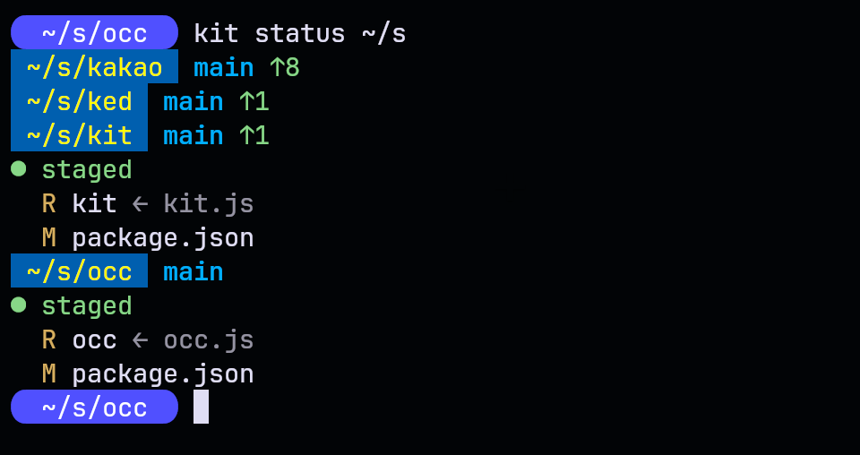
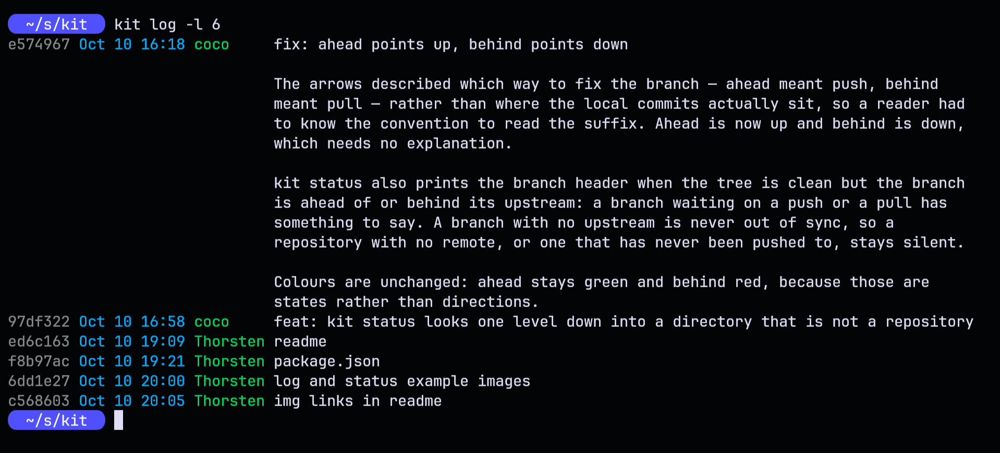

# kit

A git wrapper: `status`, `add`, `commit`, `log`. No dependencies, no build
step.

    kit status [path...]      the working tree, silent when clean and in sync
    kit add [path...]         stage changes, then show what was staged
    kit commit [words...]     stage, then commit using the words as the message
    kit log [n] [-l]          one line per commit, optionally the full message





## Notes

- `kit commit` always stages first. For the rare cases where that is wrong,
  use git directly.

## Install

```
    git clone https://github.com/monsterkodi/kit.git
```
